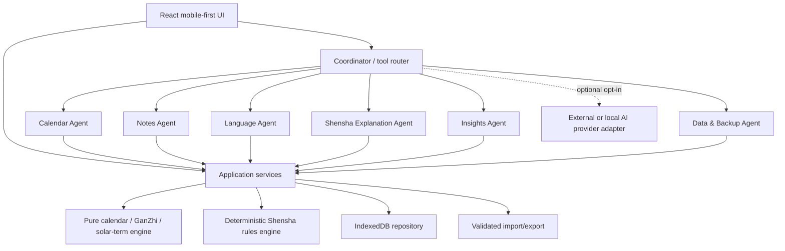

# Calendar — Product Specification and Multi-Agent Implementation Plan

Version: 1.0 (design baseline)\
Date: 2026-11-14\
Status: Proposed; no existing repository modified

## 1. Executive decision

- Official display name: **Calendar**.
- AI user interface: **Calendar Assistant**.
- Internal user-agent system: **Calendar Agents**.
- Proposed new repository: `calendar182` (confirm availability before creation).
- Existing application: **Health Calendar**, retained unchanged at https://shrg182.github.io/health-calendar/.
- Existing source reference: https://github.com/shrg182/health-calendar.
- Build an independent new application rather than rename or overwrite the existing repository.
- No Supabase or other required cloud backend. Calendar calculations, notes, and Shensha settings must work offline.

## 2. Scope and priorities

### P0 — Feature-parity baseline

1. Gregorian, Chinese lunar, and combined modes; combined is the default.
2. Date grid with month navigation, Today, date search, and month/year selection (supported baseline range: 1901–2100).
3. Existing views and date-navigation behavior, including month/week/continuous-date views where present in the source.
4. Day-detail screen with Gregorian and lunar details, GanZhi year/month/day/hour pillars, and solar terms; preserve documented calculation conventions and visibly mark approximations.
5. Daily free-text note by Gregorian `YYYY-MM-DD`, save/edit/delete, note indicators, unsaved-draft protection, and search where supported.
6. Existing Shensha configuration, named targets, custom slots, matching logic, period shortcuts/custom ranges, repeat indicators, pillar/hour rules, and accessibility labels.
7. Chinese, English, Japanese, Russian, and French UI translations, retaining reference Chinese terminology where applicable.
8. JSON export/import with full validation, preview, and conflict options, plus offline PWA installation and update management.
9. Mobile accessibility: readable lunar text, 44 px minimum touch targets, safe-area insets, 16 px minimum form inputs, focus states, keyboard support, and tested iOS Safari behavior.
10. No hidden dependency on an AI model or server for the calendar's core functions.

### P1 — Agent-assisted usability

- Natural-language date lookup and navigation.
- Note search, grouping, and non-destructive summarization.
- Explanations of calendar terms and already-calculated Shensha results (not invented calculations).
- Multilingual answers and UI help.
- Backup-health checks and import previews.
- Explicit confirmation before agents write, replace, or delete stored data.

### P2 — Optional later capabilities

- A separately designed multi-device sync service and authentication without Supabase.
- Optional integration with external calendar standards and providers.
- AI provider adapter and user-configurable model, with explicit permissions, privacy notice, cost controls, and graceful offline fallbacks.

## 3. Non-goals for initial release

- Do not implement Supabase.
- Do not silently transfer notes to any AI service.
- Do not claim browser IndexedDB is encrypted or a reliable backup by itself.
- Do not make Shensha or solar-term predictions via a language model.
- Do not equate multi-device account sync with local-only persistence: existing account workflows are retained as requirements, but cannot be considered implemented until a replacement is built and tested.
- Do not alter the existing Health Calendar code, deployment, data storage, or users.

## 4. Information architecture and user interface

### Primary navigation

Mobile bottom navigation: **Calendar | Notes | Assistant | Settings**. Desktop: left or top navigation using the same destinations. Keep calendar view accessible with one tap.

### Screen A: Calendar

- Header: Calendar logo/name, search, language, settings.
- Month/year title, previous/next, Today, quick view switch.
- Weekday header and seven-column responsive month grid.
- Date cell: Gregorian day, compact lunar day, optional note indicator and accessible selection state.
- Selected day summary below grid; tap opens a full day-detail view/panel.
- Switchable Gregorian-only, lunar-only, and combined views; persist preference locally.
- A restrained, accessible green accent; ensure status is never communicated by color alone.

### Screen B: Day details

- Gregorian date; lunar date; zodiac/sexagenary markers; solar terms; GanZhi year/month/day/hour groups.
- Existing Shensha matches by pillar, hour expansion rules, repeat indicators, and Kongwang distinctions.
- Daily note editor with visible Saved / Unsaved / Error states and explicit Save/Delete.
- Back-navigation preserving drafts.
- Shareable date URL while avoiding disclosure of private notes through URLs.

### Screen C: Notes

- Search saved notes; filter by date or month; open original day.
- Import/export functions and understandable storage status.
- Assistant summaries are previews only until the user deliberately saves output.

### Screen D: Shensha settings and encounter lists

- Searchable item selection, target chips, custom target slots, grouped named matches.
- Period shortcuts and custom inclusive ranges; results paginated in 31-day blocks.
- Preserve underlying rules documented in the original app rather than simplify them for aesthetics.

### Screen E: Assistant

- Compact entry point on Calendar plus dedicated conversational screen.
- Example prompts: “Go to next Thursday”; “Find notes mentioning travel”; “Explain today’s GanZhi”; “Summarize my notes from last month.”
- Display source dates and explain which calculation engine or notes produced the answer.
- Permission prompt for any note write; clear distinction between local deterministic commands and optional external AI.

### Screen F: Settings

- Calendar and language preferences; Shensha settings; notes/backups; offline install; app version/update notices; agent/AI permissions.
- Reserve a future Accounts & Sync section but do not imply local-only data is automatically synced.

## 5. Runtime architecture



### Roles and boundaries

| Agent | Responsibility | Allowed tools | Forbidden without approval |
|---|---|---|---|
| Coordinator | Understand intent; select tools; report results | Read-only search/navigation tools | Silent writes |
| Calendar Agent | Date navigation and lookup | Calendar engine | Changing calculation conventions |
| Notes Agent | Search and organize notes | Read notes; prepare drafts | Save/delete without confirmation |
| Language Agent | Translate/explain content | Translation catalogs, optionally AI | Changing stored text silently |
| Shensha Explanation Agent | Explain deterministic matches | Shensha engine and provenance | Inventing match results |
| Insights Agent | Summaries of selected date ranges | Authorized read-only notes | Unconsented data transfer |
| Data & Backup Agent | Export/import preview and integrity checks | Backup service and validator | Destructive import without review |

Agent orchestration can start as a deterministic command router. A generative model is an optional adapter; absence of model credentials must not break Calendar.

## 6. Technical stack

- React + TypeScript + Vite.
- React Router for navigable views and date URL state.
- IndexedDB with explicit versioned schemas and migration tests.
- Service worker/PWA for cached application shell.
- CSS variables/tokens and reusable responsive components; no heavyweight UI framework required.
- Vitest for pure-unit tests; Playwright for browser and offline tests.
- GitHub Actions for tests and GitHub Pages deployment.
- Avoid storing AI provider secrets in a static client. A provider requiring secret API credentials needs a separately designed secure intermediary or an explicitly user-controlled local option.

### Suggested directory structure

```text
calendar182/
├── docs/
│   ├── PRODUCT_SPEC.md
│   ├── AGENTS.md
│   ├── FEATURE_PARITY.md
│   ├── DATA_AND_PRIVACY.md
│   └── TEST_PLAN.md
├── public/
│   ├── icons/
│   └── manifest.webmanifest
├── src/
│   ├── app/
│   ├── components/
│   ├── pages/
│   ├── features/calendar/
│   ├── features/day-details/
│   ├── features/notes/
│   ├── features/shensha/
│   ├── features/settings/
│   ├── agents/
│   │   ├── coordinator/
│   │   ├── tools/
│   │   └── providers/
│   ├── core/calendar/
│   ├── core/shensha/
│   ├── data/
│   ├── i18n/
│   └── styles/
├── tests/
│   ├── unit/
│   ├── integration/
│   └── e2e/
├── .github/workflows/
└── package.json
```

## 7. Storage, migration, privacy, and synchronization

- Use a new IndexedDB database name and PWA storage namespace for Calendar; never automatically reuse or mutate Health Calendar's storage.
- Version every data schema and export format.
- Store notes keyed to Gregorian civil dates without timezone-induced key shifts.
- Default import conflicts to keeping existing records; preview affected dates and record counts before commit.
- Provide user-controlled export/import migration from Health Calendar; test that old exports are accepted without data loss.
- Preserve conflicting payloads for review; never deduplicate based only on timestamp.
- Prevent closing/navigating/update refresh from silently losing an unsaved note.
- AI access to note contents must be opt-in, scoped, and reversible. Show whether requests are executed locally or transmitted externally.
- For multi-device parity, later specify server authentication, revision checks, tombstones, account isolation, offline queueing, and conflict resolution. Do not mark sync feature complete without cross-device tests.

## 8. Codex development agent team

1. **Coordinator Agent**: owns backlog, architecture decision records, interfaces, integration order, and release acceptance.
2. **Frontend Agent**: implements calendar grid, layouts, responsive screens, accessibility, and visual consistency.
3. **Calendar Engine Agent**: ports/rewrites and verifies Gregorian/lunar/GanZhi/solar-term/Shensha behavior.
4. **Storage Agent**: versioned IndexedDB schema, note editing, imports/exports, update safety and future sync boundary.
5. **Testing Agent**: unit, Playwright, parity fixtures, accessibility and iOS Safari verification checklist.
6. **Reviewer Agent**: independent code/security/privacy review, rejects regressions and unverified feature claims.

### Collaboration contract

- Start with shared specification and explicit API/type contracts.
- Use isolated Git branches or worktrees; no simultaneous edits to shared files without coordination.
- Parallelize UI shell, deterministic engine, and storage only after interfaces are defined.
- Integrate sequentially: engine/storage -> UI -> assistant -> optional AI.
- Each agent submits changes, test evidence, and known limitations; Reviewer signs off before merge.
- Never modify `health-calendar`; treat it as read-only feature/reference source.

## 9. Delivery plan

### Phase 1 — Audit and specification

- Freeze Health Calendar's current feature inventory from README, code, tests, and screenshots.
- Create named parity fixtures for date bounds, leap lunar months, Shensha repeated/hour cases, translations, and data import.
- Approve screen designs, storage contract, and agent tool permissions.

### Phase 2 — Project bootstrap and UI

- Create separate `calendar182` repository.
- Set up TypeScript, Vite, React, routing, CSS tokens, PWA scaffold, and CI.
- Implement mobile-first Calendar and day-details layouts with fixtures.

### Phase 3 — Core deterministic feature parity

- Implement/date-verify combined, Gregorian, lunar, GanZhi, solar terms, and Shensha.
- Implement notes, settings, language catalogs, and date navigation.
- Compare behavior with reference tests.

### Phase 4 — Local data and offline

- Add IndexedDB migrations; validated imports/exports; unsaved-draft safety; offline/service-worker updates.
- Verify backups and recovery with intentional failure scenarios.

### Phase 5 — Agent interface

- Implement a safe local intent router and read-only tool registry first.
- Add opt-in AI provider adapter and confirmation for edits.
- Exercise data-permission and offline fallback tests.

### Phase 6 — Release

- Run automated suites and real-device mobile Safari verification.
- Publish to independent GitHub Pages origin/path and test installed PWA.
- Keep Health Calendar deployed as-is.

## 10. Acceptance criteria

- Existing Health Calendar repository and deployment show no changes.
- Combined month view is the default; all calendar modes function within agreed date range.
- Date details and Shensha calculations match approved baseline fixtures, including boundary and timezone cases.
- Notes persist across refresh, survive app updates, and are recoverable through tested backup/import.
- All five languages load and date keys remain unaffected by language changes.
- Calendar works in airplane/offline mode after initial install; assistant gives a clear unavailable response when optional AI needs connectivity.
- No horizontal overflow at representative iPhone widths; touch targets, focus behavior, and text scaling pass accessibility checks.
- Agents cannot silently change notes or export data to a model provider.
- Claims of multi-device sync are withheld until a replacement backend is implemented and verified.

## 11. First Codex instruction (copy into a new Calendar workspace)

> Create a brand-new repository/application named `calendar182` with display name `Calendar`. Keep `shrg182/health-calendar` entirely unchanged. Use its public source only as a read-only behavior specification, not as a target to modify. Start by auditing its features and tests and producing `docs/FEATURE_PARITY.md`; then scaffold React + TypeScript + Vite with a responsive, accessible combined Gregorian/lunar month view. Create architecture interfaces for deterministic calendar and Shensha engines, local IndexedDB notes, and optional tool-based Calendar Agents. No Supabase and no required AI API. Do not claim feature parity until explicit regression tests pass. Work in branches/worktrees, run lint, build and tests, then report files changed, checks run, and remaining gaps.

## 12. Source/reference caveat

This specification uses the public Health Calendar repository README as a baseline reference, checked 2026-11-14. It is a design and implementation plan, not a completed audit of every source file or verified test run. Confirm detailed parity against original source and tests in Phase 1.
