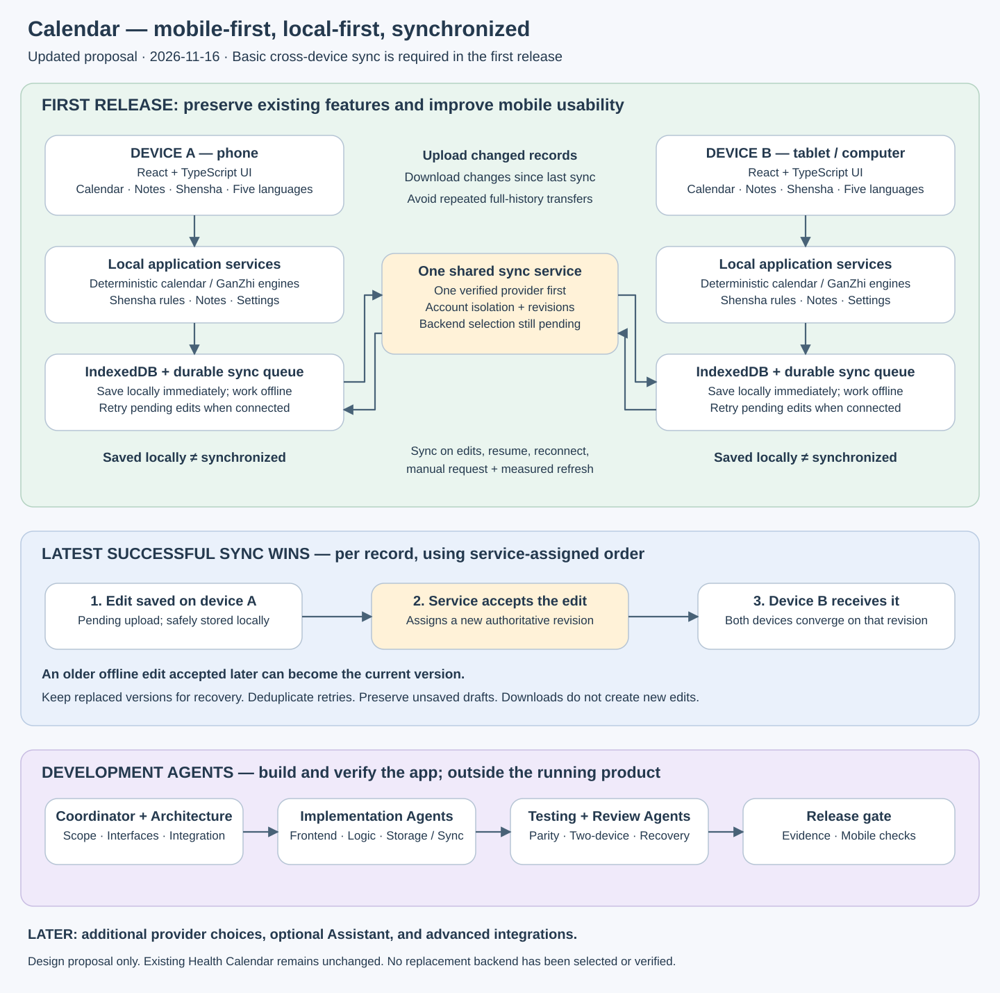

# Calendar: updated architecture

Date: 2026-11-16. Proposed design; not an implemented system.

This illustration supersedes the earlier diagram's treatment of sync as a later addition. It follows [the updated requirements](./REQUIREMENTS_UPDATE.md).

- Each device runs the mobile-first React interface, deterministic calculations, and local storage.
- A durable queue retains changes until one supported sync service accepts them.
- Other devices retrieve changes rather than repeatedly downloading the full account history.
- The service orders accepted edits per record. The last successfully accepted edit wins; recovery history retains replaced versions.
- An old offline edit accepted later can replace the current record. Retried operations are deduplicated so they do not become new edits.
- Development agents build and test the system. An optional user-facing Assistant is deferred.

The backend choice, precise traffic budget, recovery retention, and real-device validation remain open. Calendar calculation changes require documented reference evidence; the diagram makes no claim of improved calculation accuracy.
