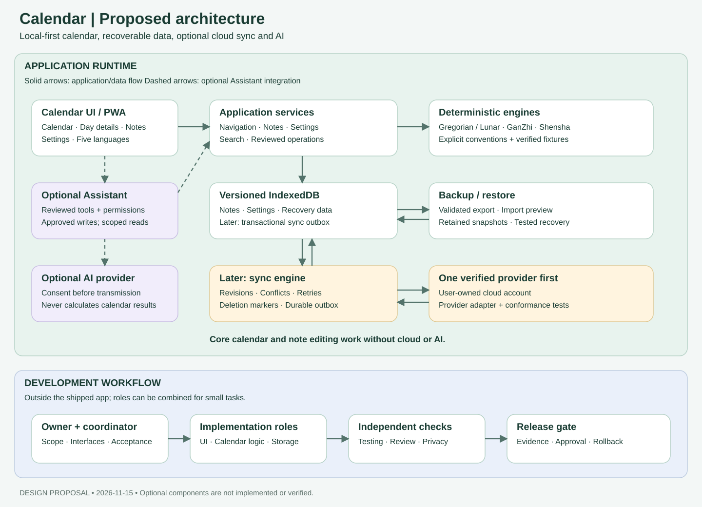

# Calendar design review and recommendations

Date: 2026-11-15\
Status: Recommendations for discussion; not an approved implementation specification.

**Update 2026-11-16:** The owner requires basic automatic cross-device sync in the initial release and prefers latest-successful-sync-wins. See [Requirements update](./REQUIREMENTS_UPDATE.md), which supersedes the earlier release-sequencing and mandatory conflict-resolution suggestions below. Existing illustrations still depict sync as a later addition and are historical proposals.

## Overall assessment

The proposed direction is sound: protect the existing Health Calendar, keep calculations deterministic, save locally first, provide recoverable backups, and make AI optional. Before implementation, reconcile the documents into one release plan and complete a read-only audit of the reference application.

This review covers both Markdown documents and all four diagrams in `../design/`. The workspace contained design files only at review time. The existing application's source, calendar accuracy, cloud APIs, and deployment behavior have not been independently verified.

## Decisions to reconcile

| Topic | Current inconsistency | Recommendation |
|---|---|---|
| Initial release | The specification postpones sync; the Codex instructions require a working provider on two devices. | Define a local-first release and a separate sync release. If sync is essential at launch, explicitly accept the larger scope. |
| Assistant | The specification gives Assistant a primary navigation destination and P1 priority; the instructions defer it. | Add it after calendar, notes, backup, and recovery are reliable. |
| Backend | One document prohibits Supabase; the other prohibits making it required. | Adopt one policy. Suggested baseline: no required cloud backend; any future backend needs a separate decision. |
| Health features | One image introduces exercise, medication, reports, and advice without corresponding requirements. | Mark these as exploratory and exclude them from baseline scope. |
| Agents | Some diagrams mix development roles with running application components. | Maintain separate development and runtime diagrams. |
| Naming | Parity document names and directory layouts differ. | Standardize on `FEATURE_PARITY_MATRIX.md` and one source layout. |

## Recommended architecture

The illustration is a proposed target architecture, not evidence of implemented features. Its runtime and development lanes are intentionally separate. The optional components should not block ordinary calendar use.

### Runtime

1. The responsive UI calls application services directly for normal calendar and note operations.
2. Pure calendar and Shensha engines own calculations. Their conventions and reference fixtures must be explicit.
3. Notes and settings services save to versioned IndexedDB. Persist an outbox transactionally with edits when sync is introduced.
4. Import/export supplies validated, complete backups. Retained snapshots and restore procedures protect against errors that synchronization could propagate.
5. A later sync engine handles revisions, retries, conflicts, and deletion markers through one verified provider adapter first.
6. An optional Assistant calls reviewed tools through a permission boundary. External AI receives only explicitly authorized data. Ordinary UI actions do not need an agent router.

### Development

A coordinator maintains requirements, interfaces, and integration decisions. Implementation roles build modules; independent testing and review check them before release. These roles describe how software is produced, not processes that must run inside the shipped app. Combine roles for small tasks and separate them where independent review is valuable.

Editable diagram source: [calendar-architecture.mmd](./calendar-architecture.mmd).

## Detailed suggestions

### 1. Establish one source of truth

Use `CALENDAR_SPECIFICATION_AND_AGENTS.md` for product requirements and `CODEX_INSTRUCTIONS.md` for execution rules. Requirements should identify release priority, acceptance evidence, and unresolved decisions. Mark diagrams as illustrative and subordinate to the approved text.

### 2. Audit before choosing how much to rewrite

An independent application and deployment are sensible safety boundaries. They do not require rewriting all existing logic. Inspect the reference source, tests, dependencies, and license; reuse suitable logic where justified. Record each feature's reference behavior, intended behavior, test evidence, and status. Do not equate a framework migration with improved calendar accuracy.

### 3. Define calculation conventions

Document calculation timezone, solar-term precision, GanZhi year/month transitions, day rollover, hour-pillar conventions, leap-month handling, and supported date limits. Specify behavior near the edges of the supported range. Keep note civil dates separate from timestamps and astronomical instants. Include both parity tests and independent correctness checks: matching an old defect does not establish accuracy.

### 4. Specify storage and deployment isolation

Use distinct IndexedDB names, local-storage keys, caches, and service-worker scopes. Different GitHub Pages project paths under the same hostname share an origin; paths alone do not isolate all browser storage. A separate origin provides stronger isolation. Test that installing or updating the new PWA cannot interfere with the original app's assets or data.

### 5. Separate backup from synchronization

Synchronization can distribute accidental deletions and corrupted records. Define snapshot retention, restore previews, integrity validation, and recovery after long offline periods. Test storage failures, interrupted imports, schema upgrades, and updates while a draft is open. Browser storage remains working storage, not an independent backup.

### 6. Refine the sync contract before implementation

Distinguish create-if-absent from update-if-revision-matches and conditional deletion. An optional `expectedRevision` argument leaves overwrite semantics unclear. Specify stable record IDs, operation IDs, retry behavior, provider/account identity, and schema compatibility. Define how old devices interact with expired tombstones so deleted records do not silently reappear. Provider switching must preserve pending edits and clearly identify the destination account.

Provider API support, browser OAuth, CORS, token handling, and mainland China accessibility remain feasibility questions. Validate them using current official documentation and a small prototype before promising a provider. Do not expose unimplemented integrations as functioning settings.

### 7. Keep the Assistant small and optional

Begin with ordinary modules and a deterministic command interface where useful. Add a single tool-using Assistant only when specific user tasks justify it. Search and calculation should use application services; explanations should cite calculated results or source dates. Require deliberate approval for proposed Assistant writes and consent before external transmission. Do not require extra confirmation for ordinary user-directed Save actions.

### 8. Add user-interface designs

Create mobile mockups for combined month view, day details and note editing, Shensha configuration, and backup/conflict recovery. Verify long translations, large text, keyboard focus, screen-reader labels, and comfortable touch interaction. Hide the Assistant destination until available. Surface meaningful states such as Saved, Pending changes, Conflict, and Restore preview without requiring users to understand internal implementation.

## Diagram review

| File | Recommended treatment |
|---|---|
| `Calendar Multi-Agent Development Architecture.png` | Closest to the proposed scope. Separate development arrows from runtime data flow; label sync and AI as future/optional. |
| `Health Calendar Multi-Agent Architecture.png` | Retain as exploratory. It expands into unapproved health features and suggests a broader storage/provider scope than verified. |
| `Reader Notes Multi-Agent Architecture.png` | Keep as a development-workflow reference, not Calendar's application architecture. Its backend assumptions are not Calendar requirements. |
| `Reader Notes_ AI Agents vs. Modules.png` | Useful conceptual reference for distinguishing development agents, runtime assistants, and software modules. |

## Recommended delivery sequence

| Stage | Deliverable | Exit evidence |
|---|---|---|
| Discovery | Read-only feature audit, calculation conventions, import examples, dependency/license inventory, and mobile screen proposals | Reviewed parity matrix and explicit scope decisions |
| Local release | Calendar parity, notes, five languages, offline operation, import/export, draft protection, safe updates | Parity checks, recovery tests, browser tests, and real-device checks |
| Sync release | One verified provider, durable outbox, revisions, conflict resolution, recovery | Two-device concurrent-edit and failure-recovery evidence |
| Optional enhancements | Assistant, additional providers, separately approved health features | Feature-specific acceptance, privacy checks, and regression evidence |

## Next smallest verifiable step

Reconcile the release scope and backend policy, then perform the reference audit and produce `FEATURE_PARITY_MATRIX.md`. Do not treat this review or its illustration as authorization to create a repository, migrate data, connect cloud accounts, or deploy an application.
