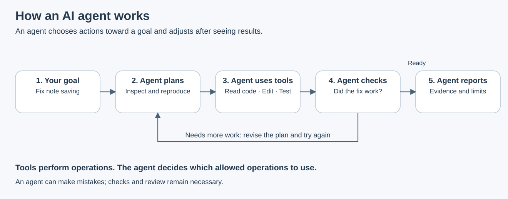
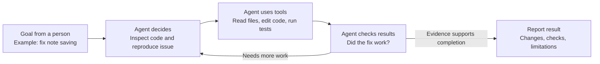
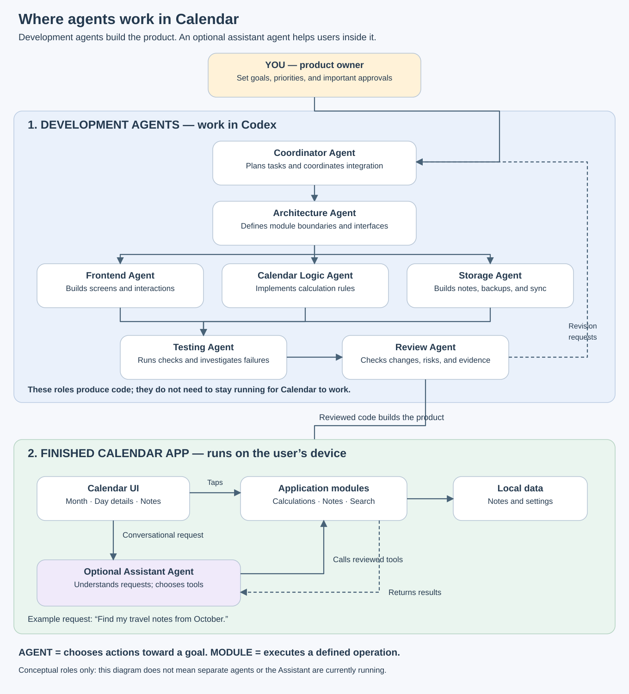
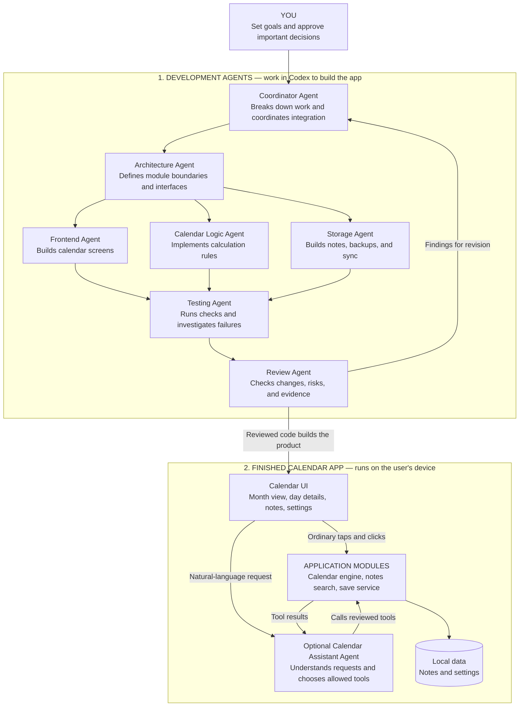

# Understanding agents in Calendar

An AI agent receives a goal, chooses actions and tools within its permissions, examines results, and adjusts its next step. The surrounding software supplies the tools, boundaries, and execution environment. An agent can still make mistakes; tests and review remain necessary.

## The agent's working loop

## Two places agents can work

The development agents produce code; they do not need to remain running for Calendar to work. The optional Assistant is part of the user experience and uses the finished application's services.

## Concrete distinction

| Agent or module | Example |
|---|---|
| Storage Agent during development | Investigates lost notes, edits storage code, runs recovery tests, and reports evidence. |
| Notes module in the finished app | Executes a defined save operation when called. |
| Optional Assistant Agent in the finished app | Interprets “Find my travel notes from October,” calls search tools, and presents the results. |

An agent chooses which allowed operations to perform toward a goal. A module executes the operation it was given. Modules may themselves use AI; using AI alone does not make a module an agent.

## What “multi-agent” means

Multiple agent instances can receive separate assignments and exchange results, coordinated around shared requirements. Merely naming several roles in a diagram does not create separate running agents. One agent can also take several roles sequentially. Separate agents are useful when independent investigation, parallel work, or review justifies the coordination overhead.

These are conceptual diagrams. They do not mean that all these agents or the optional Calendar Assistant currently exist or are running.
